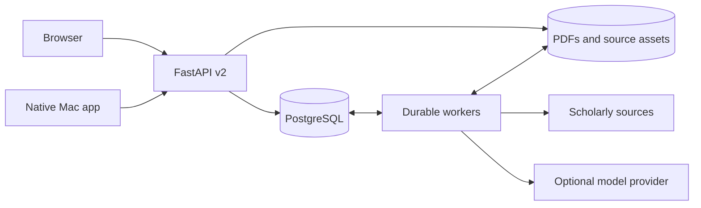

# Paper NAS

**A native Mac workspace for papers, evidence, and research decisions. Backed by your own server.**

[](https://github.com/ezoiHY/PaperNAS/actions/workflows/ci.yml)
[](LICENSE)
[](backend/pyproject.toml)
[](macOS/README.md)

Paper NAS brings a SwiftUI Mac app, a browser client, and a self-hosted research library together. Read original PDFs, move through carefully typeset analyses, follow citations to source passages, and connect evidence to research questions. Your NAS, home server, or local machine keeps the library and background work in one place.

**Version 0.5.0 · early release · single-user workspace**

[Mac app tour](docs/MACOS-GALLERY.md) · [Quick start](#quick-start) · [Web gallery](docs/SCREENSHOTS.md) · [Deployment](docs/DEPLOYMENT.md) · [中文介绍](docs/README.zh-CN.md)


*The running Mac app: chapter navigation, typeset reading, and source citations. All screenshots use synthetic demonstration content; analyses and diagrams do not represent published research or experimental results. Mac interface labels are currently primarily Chinese.*

## From reading to a research decision

1. **Collect.** Import a PDF, paper URL, DOI, or arXiv identifier. Search arXiv and Crossref for candidates, then choose what belongs in your library.
2. **Read.** Open the original PDF, inspect extracted text and figures, and save notes against a specific PDF version and page.
3. **Connect.** Link papers to a research question. Save exact passages or figures as evidence while keeping their original source anchors.
4. **Decide and revisit.** Record a judgment, state a verification plan, add results from work performed outside the app, and update your understanding with history preserved.

Model-assisted analysis and comparison are optional. Reading, notes, and research records work without a model provider. When enabled, the server sends bounded excerpts to your configured OpenAI-compatible provider and validates cited quotations before publishing an analysis.

## Built for reading on Mac

SwiftUI navigation, native sheets, and a quiet reading layout keep the paper at the center. Switch between list and illustrated library views, read PDFs with PDFKit, and follow an analysis back to its original evidence. Mathematical text renders locally with KaTeX.

| Browse a visual library | Read the PDF beside your notes |
| --- | --- |
| [](docs/images/macos-library-grid.jpg) | [](docs/images/macos-pdf-notes-light.jpg) |
| Paper and figure previews, groups, search, and a separate candidate queue. | Original pages, native text selections, region anchors, and notes tied to a PDF version. |

| Settle into focused reading | Inspect the original figures |
| --- | --- |
| [](docs/images/macos-focus-reading.jpg) | [](docs/images/macos-figures.jpg) |
| Hide the contents sidebar while keeping chapter navigation and source citations within reach. | Enlarge a figure, open its source page, correct its region, or save it as research evidence. |

| Bring evidence into a question | Turn a judgment into a plan |
| --- | --- |
| [](docs/images/macos-research-evidence.jpg) | [](docs/images/macos-research-plans.jpg) |
| Keep papers, exact quotations, figures, and your own observations together. | Record assumptions, methods, baselines, and success criteria; revisit them as evidence changes. |

**[Explore the full Mac app tour →](docs/MACOS-GALLERY.md)** — 17 screenshots covering the library, candidates, reading, source text, PDFs, figure correction, evidence capture, research records, comparison, tasks, and dark appearance.

## The same workspace in your browser

The browser connects to the same library, research records, and durable tasks. Use it from another computer or a phone while the server continues importing and processing papers. Each client receives its own device token; the Mac app stores its token in Keychain.


See the **[web gallery](docs/SCREENSHOTS.md)** for PDF reading, figures, research records, dark appearance, and the mobile layout.

## What is included

- Import PDFs, paper URLs, DOIs, and arXiv identifiers. Discover candidates through bounded arXiv and Crossref searches.
- Read original PDFs, extracted text, figures, and saved analyses. Organize papers into groups and keep notes tied to a PDF version and page.
- Build research questions around papers and exact source evidence. Record revisable judgments, verification plans, actual results, and evolving understanding.
- Run model-assisted paper analysis and cross-paper comparison using your own OpenAI-compatible provider. Citations must match supplied source text before an analysis is published.
- Inspect, pause, resume, cancel, and retry durable background operations. Work continues after the browser or Mac app closes.
- Export PDFs, original figures, analysis Markdown, and research records in Markdown or JSON.

The browser has light and dark appearance, a responsive mobile layout, and keyboard-accessible controls. It uses plain ES modules and CSS, with no CDN, external fonts, analytics, or frontend build step. Node is only needed for frontend checks.

## Quick start

Requirements: Python 3.12+, PostgreSQL 18 (the tested major version), and a modern browser. The Mac app additionally needs macOS 14+ and Swift 6/Xcode Command Line Tools. Node 22+ is only needed for frontend tests.

### Local development on macOS

```sh
git clone https://github.com/ezoiHY/PaperNAS.git
cd PaperNAS
python3.12 -m venv backend/.venv
backend/.venv/bin/python -m pip install -e './backend[test]'
backend/.venv/bin/python backend/scripts/bootstrap_postgres.py
backend/.venv/bin/python backend/scripts/dev_database.py start
backend/.venv/bin/python backend/scripts/dev.py init
backend/.venv/bin/python backend/scripts/dev.py show-access-key
```

The bootstrap downloads, verifies, and builds a local PostgreSQL installation. For an existing PostgreSQL service, use the [backend instructions](backend/README.md#existing-postgresql). The development cluster uses loopback-only trust authentication and is not a production configuration.

In one terminal:

```sh
backend/.venv/bin/python backend/scripts/dev.py api
```

In a second terminal:

```sh
backend/.venv/bin/python backend/scripts/dev.py worker
```

Open **[http://127.0.0.1:8788/app/](http://127.0.0.1:8788/app/)** and enter the access key printed in your own terminal. The browser receives a separate device token; it does not retain the shared access key.

Install optional structural parsing with `backend/.venv/bin/python -m pip install -e './backend[layout]'`. Docling downloads model files on first use. Without it, Paper NAS uses embedded PDF text and page/region rendering. OCR is not enabled by this application.

### Native Mac app

```sh
bash scripts/build-app.sh release
open 'dist/Paper NAS.app'
```

Connect to the same API address and access key. Each Mac receives a device token stored in Keychain. Source builds are ad-hoc signed, not Apple-notarized. See [Mac build instructions](macOS/README.md).

### Containers

Docker Compose templates are included for Linux hosts:

```sh
cp .env.example .env
# Set POSTGRES_PASSWORD in .env to a randomly generated hex password.
docker compose up --build -d
docker compose exec api papernas-v2 show-access-key
```

The default mapping is `127.0.0.1:8788`; PostgreSQL has no host port mapping. Configure HTTPS or a trusted private network for remote access. See the [deployment guide](docs/DEPLOYMENT.md). The Compose template requires Docker Compose v2 and is separate from the verified bare-metal path.

## How it fits together



PostgreSQL stores the library, research records, revisions, and task queue. Content-addressed files retain source documents and derived assets. API and worker processes can run separately; business changes and task enqueueing share a database transaction. See [architecture and consistency](docs/ARCHITECTURE.md) for the detailed boundaries.

| Directory | Purpose |
| --- | --- |
| `backend/` | FastAPI API, PostgreSQL schema, durable workers, document processing, and tests |
| `frontend/` | Browser client, plain ES modules and CSS, API client tests |
| `macOS/` | Native SwiftUI client, PDFKit reader, resources, and Swift tests |
| `deploy/` | Container and systemd examples |
| `scripts/` | Mac build, source packaging, and public-source audit tools |
| `docs/` | Setup, architecture, API conventions, release process, and limitations |
| `design-system/` | Native and web UI design rules |
| `legacy/` | Frozen v1 adapter and migration-era scripts; not the current server |

The current backend is independent of the earlier `research-digest` engine. A fresh installation does not need that project.

## Check the code

```sh
backend/.venv/bin/pytest -q backend/tests
backend/.venv/bin/ruff check backend/papernas_v2 backend/tests backend/scripts
node --test frontend/tests/*.test.js
bash scripts/test-mac.sh
python3 scripts/audit-public.py
```

Backend tests create and drop randomly named databases on a disposable PostgreSQL cluster and use local synthetic model responses. Set `PAPERNAS_V2_TEST_ADMIN_URL` for a test database administrator, never a production database. Database tests skip if no test URL or local cluster is available; a skipped run is not full verification.

## Current limits

- One personal workspace shared by authorized devices; no multi-tenant or role-based isolation.
- Browser notes use manually chosen pages and quotations. Native PDF selection rectangles are available in the Mac app. Browser reading positions are synchronized through the explicit page control.
- Analyses can be wrong even when quotations match. Check the original material. Models receive bounded excerpts, not guaranteed complete paper coverage.
- Discovery collects candidates without automatic selection or deep analysis. Token budgets are not currency limits.
- Semantic search, Zotero sync, OpenReview/PMLR ingestion, scanned-document OCR, and experiment execution are not implemented.
- No hosted sync service, Windows/Linux native clients, signed Mac releases, or automatic updates.

See [feature boundaries](docs/FEATURES.md) for client differences and [verification results](docs/VERIFICATION.md) for tested paths.

## Contributing and support

Bug reports and focused improvements are welcome. Read [CONTRIBUTING.md](CONTRIBUTING.md), include the relevant client/server version, and use synthetic examples when reporting a problem.

- [Report a bug](https://github.com/ezoiHY/PaperNAS/issues/new?template=bug_report.md)
- [Discuss an idea or request a feature](https://github.com/ezoiHY/PaperNAS/issues)
- [Report a security concern](SECURITY.md)
- [Read the changelog](CHANGELOG.md) and [release process](docs/RELEASING.md)

## License and research data

Copyright 2026 Harry Han and Paper NAS contributors. Source is provided under **AGPL-3.0-only**; see [LICENSE](LICENSE) and [third-party notices](THIRD-PARTY-NOTICES.md). Release packaging includes corresponding source and preserves vendored notices.

PDFs, figures, notes, credentials, databases, and model responses are not included or licensed by this software license. Public-source audit and packaging tools exclude runtime state, private deployment records, credentials, caches, backups, and built applications.
