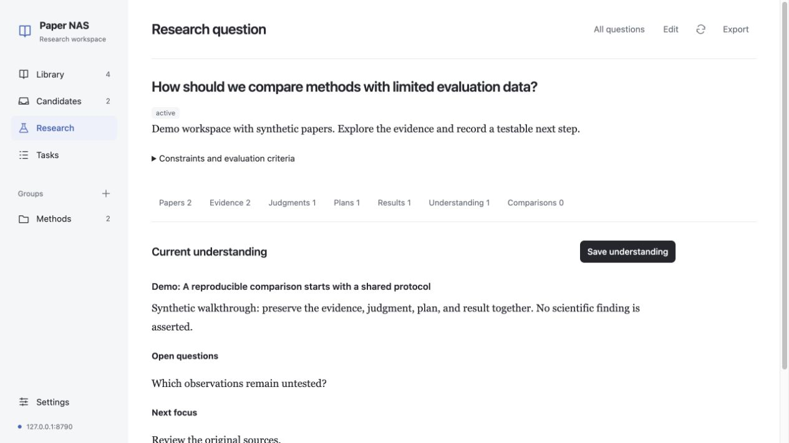

# Paper NAS

A self-hosted research workspace with a browser client and a native Mac app. Keep papers, figures, notes, source evidence, research judgments, and background jobs on your own server.

**Version 0.5.0 · early release · single-user workspace · AGPL-3.0**

[Quick start](#quick-start) · [Deployment](docs/DEPLOYMENT.md) · [Architecture](docs/ARCHITECTURE.md) · [Contributing](CONTRIBUTING.md) · [中文](docs/README.zh-CN.md)

## What it does

- Import PDFs, paper URLs, DOIs, and arXiv identifiers. Discover candidates through bounded arXiv and Crossref searches.
- Read original PDFs, extracted text, figures, and saved analyses. Organize papers into groups and keep notes tied to a PDF version and page.
- Build research questions around papers and exact source evidence. Record revisable judgments, verification plans, actual results, and evolving understanding.
- Run model-assisted paper analysis and cross-paper comparison using your own OpenAI-compatible provider. Citations must match supplied source text before an analysis is published.
- Inspect, pause, resume, cancel, and retry durable background operations. Work continues after the browser or Mac app closes.
- Export PDFs, original figures, analysis Markdown, and research records in Markdown or JSON.

The browser client follows a quiet library layout: a narrow sidebar, readable paper rows, restrained blue selection, and a focused reading area. It has no CDN, external fonts, analytics, build framework, or JavaScript runtime dependency on the server. The Mac client uses SwiftUI, PDFKit, and local KaTeX for math.



The screenshot uses synthetic demonstration content, not real papers or research findings.

## Repository map

| Directory | Purpose |
| --- | --- |
| `backend/` | Python/FastAPI API, PostgreSQL schema, durable workers, document processing, and tests |
| `frontend/` | Working browser client, plain ES modules and CSS, API client tests |
| `macOS/` | Native SwiftUI client, PDFKit reader, resources, and Swift tests |
| `deploy/` | Container and systemd examples; private configuration is supplied separately |
| `scripts/` | Mac build, source packaging, and public-source audit tools |
| `docs/` | Setup, architecture, API conventions, release process, and limitations |
| `design-system/` | Native and web UI design rules |
| `legacy/` | Frozen v1 API adapter and migration-era scripts; not the current server |

The current backend is independent of the earlier `research-digest` processing engine. A fresh installation does not need that project. The old engine and its web UI are not included or required.

## Quick start

Requirements: Python 3.12+, PostgreSQL 18 (the tested major version), and a modern browser. The Mac app additionally needs macOS 14+ and Swift 6/Xcode Command Line Tools. Node 22+ is only needed for frontend tests.

### Local development on macOS

From the repository root:

```sh
python3.12 -m venv backend/.venv
backend/.venv/bin/python -m pip install -e './backend[test]'
backend/.venv/bin/python backend/scripts/bootstrap_postgres.py
backend/.venv/bin/python backend/scripts/dev_database.py start
backend/.venv/bin/python backend/scripts/dev.py init
backend/.venv/bin/python backend/scripts/dev.py show-access-key
```

The bootstrap downloads, verifies, and builds a local PostgreSQL installation. For an existing PostgreSQL service, use the [backend instructions](backend/README.md#existing-postgresql). The development cluster uses loopback-only trust authentication and is not a production configuration.

In one terminal:

```sh
backend/.venv/bin/python backend/scripts/dev.py api
```

In a second terminal:

```sh
backend/.venv/bin/python backend/scripts/dev.py worker
```

Open **[http://127.0.0.1:8788/app/](http://127.0.0.1:8788/app/)** and enter the access key printed in your own terminal. The browser receives a separate device token; it does not retain the shared access key.

Install optional structural parsing with `backend/.venv/bin/python -m pip install -e './backend[layout]'`. Docling downloads model files on first use. Without it, Paper NAS uses embedded PDF text and page/region rendering. OCR is not enabled by this application.

### Native Mac app

```sh
bash scripts/build-app.sh release
open 'dist/Paper NAS.app'
```

Connect to the same API address and access key. Each Mac receives a device token stored in Keychain. Source builds are ad-hoc signed, not Apple-notarized. See [Mac build instructions](macOS/README.md).

### Containers

Docker Compose templates are included for Linux hosts:

```sh
cp .env.example .env
# Set POSTGRES_PASSWORD in .env to a randomly generated hex password.
docker compose up --build -d
docker compose exec api papernas-v2 show-access-key
```

The default mapping is `127.0.0.1:8788`; PostgreSQL has no host port mapping. Configure HTTPS or a trusted private network for remote access. See the [deployment guide](docs/DEPLOYMENT.md). The Compose template requires Docker Compose v2 and is separate from the verified bare-metal path.

## Check the code

```sh
backend/.venv/bin/pytest -q backend/tests
backend/.venv/bin/ruff check backend/papernas_v2 backend/tests backend/scripts
node --test frontend/tests/*.test.js
bash scripts/test-mac.sh
python3 scripts/audit-public.py
```

Backend tests create and drop randomly named databases on a disposable PostgreSQL cluster and use local synthetic model responses. Set `PAPERNAS_V2_TEST_ADMIN_URL` for a test database administrator, never a production database. Database tests skip if no test URL or local cluster is available; a skipped run is not full verification.

## Current limits

- One personal workspace shared by authorized devices; no multi-tenant or role-based isolation.
- Browser notes use manually chosen pages and quotations. Native PDF selection rectangles are available in the Mac app. Browser reading positions are synchronized through the explicit page control.
- Analyses can be wrong even when quotations match. Check the original material. Models receive bounded excerpts, not guaranteed complete paper coverage.
- Discovery collects candidates without automatic selection or deep analysis. Token budgets are not currency limits.
- Semantic search, Zotero sync, OpenReview/PMLR ingestion, scanned-document OCR, and experiment execution are not implemented.
- No hosted sync service, Windows/Linux native clients, signed Mac releases, or automatic updates.

See [feature boundaries](docs/FEATURES.md) for client differences and [verification results](docs/VERIFICATION.md) for tested paths.

## License and research data

Copyright 2026 Harry Han and Paper NAS contributors. Source is provided under **AGPL-3.0-only**; see [LICENSE](LICENSE) and [third-party notices](THIRD-PARTY-NOTICES.md). Release packaging includes corresponding source and preserves vendored notices.

PDFs, figures, notes, credentials, databases, and model responses are not included or licensed by this software license. Public-source audit and packaging tools exclude runtime state, private deployment records, credentials, caches, backups, and built applications.
