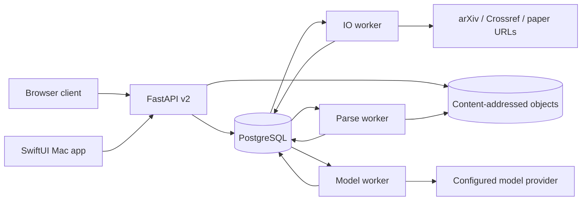

# Architecture

Paper NAS is one personal research workspace with multiple authenticated devices. PostgreSQL and the server's immutable object directory are the durable source of truth. Browser and Mac clients share the same API.

## Backend modules

| Module | Responsibility |
| --- | --- |
| `api.py`, `native_routes.py` | Authentication, API routes, idempotent mutation boundaries, native compatibility |
| `library.py`, `sources.py` | Paper identity, versions, search, groups, metadata, bounded source acquisition |
| `parsing.py`, `assets.py` | Document blocks, figure extraction/correction, original assets, SHA-256 storage |
| `research.py`, `analysis.py` | Evidence validation, judgments/history, plans/results, model analyses, comparisons |
| `operations.py`, `execution.py`, `queue.py` | Operation plans, stage dependencies, durable execution and retry |
| `models.py` | Provider calls, response retention, token reservation and uncertain-call handling |
| `db.py`, `maintenance.py` | Migrations, transactions, event outbox, recovery, scheduled discovery |
| `web_ui.py` | Same-origin static frontend and packaged corresponding source |
| `legacy.py` | Opt-in migration from frozen v1 data |

## Consistency

Business changes and Procrastinate queue writes share a PostgreSQL transaction. A request's idempotency key and canonical payload determine whether a mutation is new or a replay. Mutable records use revision checks. Stage generations fence stale attempts so old work cannot publish over newer results.

Objects are written under their content hash. Database references connect papers, versions, parsed documents, figures, and analyses. A saved evidence record keeps a source anchor to its original document/version; reparsing or correcting a figure does not silently rewrite earlier evidence.

An outbox publishes committed changes using a monotonically advancing event cursor. Clients can refresh safely; the browser currently refreshes explicitly and polls the task view, rather than maintaining a continuous event stream.

## Provider boundaries

Only bounded source blocks are sent to a configured model. Responses and usage are recorded before output is validated. Exact-quote matching checks provenance, not scientific correctness. Unknown call outcomes keep budget reserved until reconciled; retries never assume a failed connection means no charge.

## Frontends

The browser is buildless ES modules and CSS, served under `/app/`. It makes same-origin Bearer requests, rejects external resource paths and redirects, and inserts source content as text. PDF/images are fetched using the credential and rendered through short-lived blob URLs.

The Mac app is SwiftUI with PDFKit. Only mathematical text uses a network-disabled local WebKit/KaTeX surface. Device tokens live in Keychain. UI appearance, caches, and unsent drafts are device-local; committed notes and reading positions are server data.

## Deployment boundary

API and workers may run as separate processes or containers on the same machine. PostgreSQL is not publicly exposed. Backups must preserve database and object/key state together. The application does not provide per-user isolation, public registration, or a general untrusted multi-tenant execution environment.
