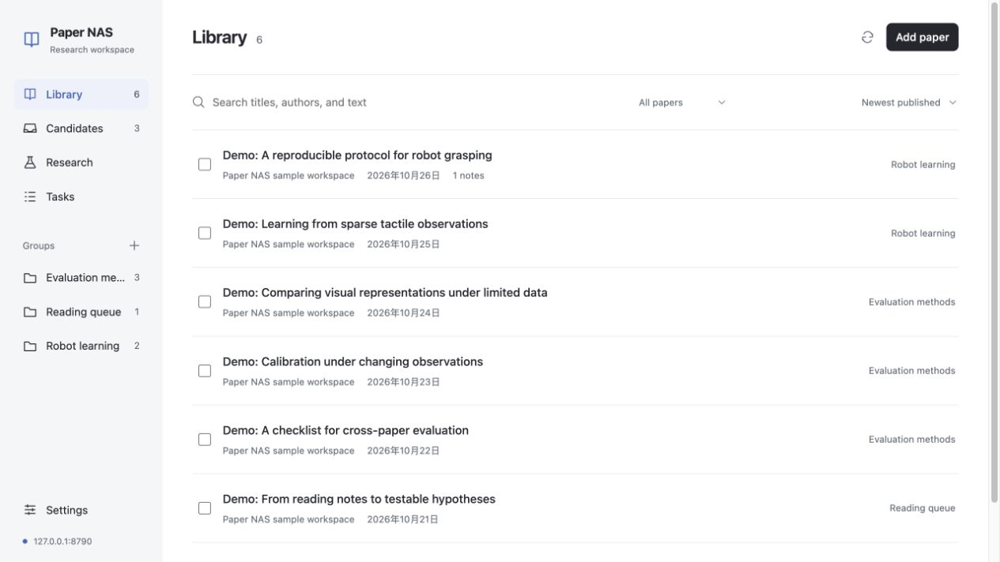
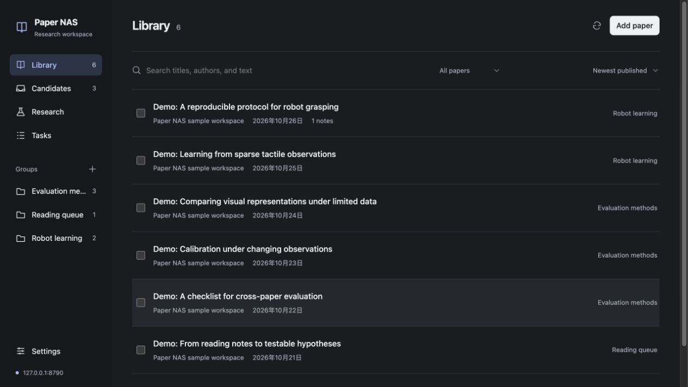
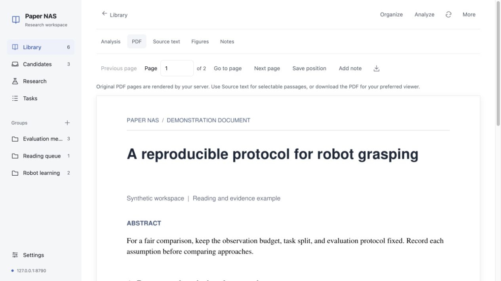
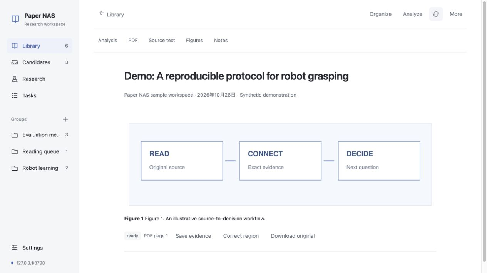
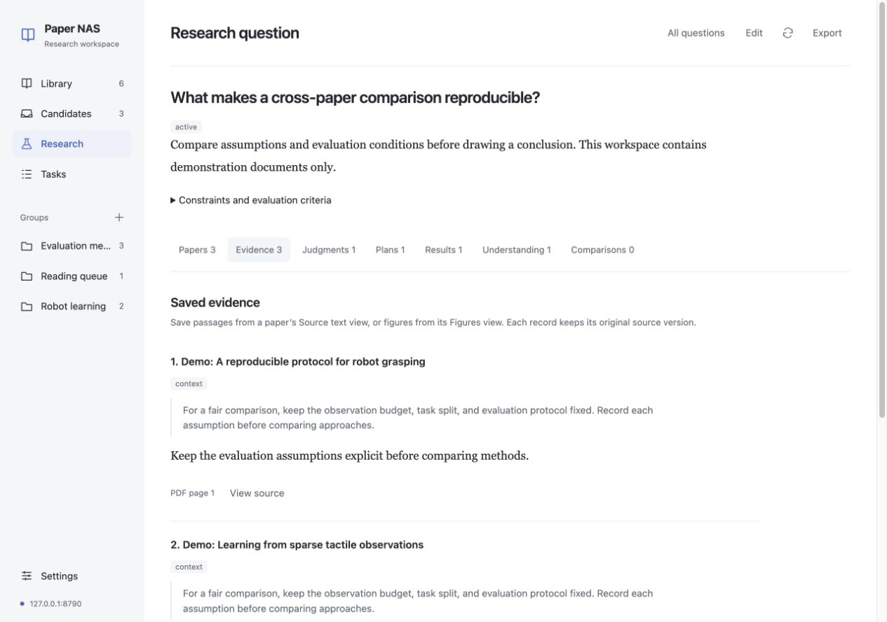
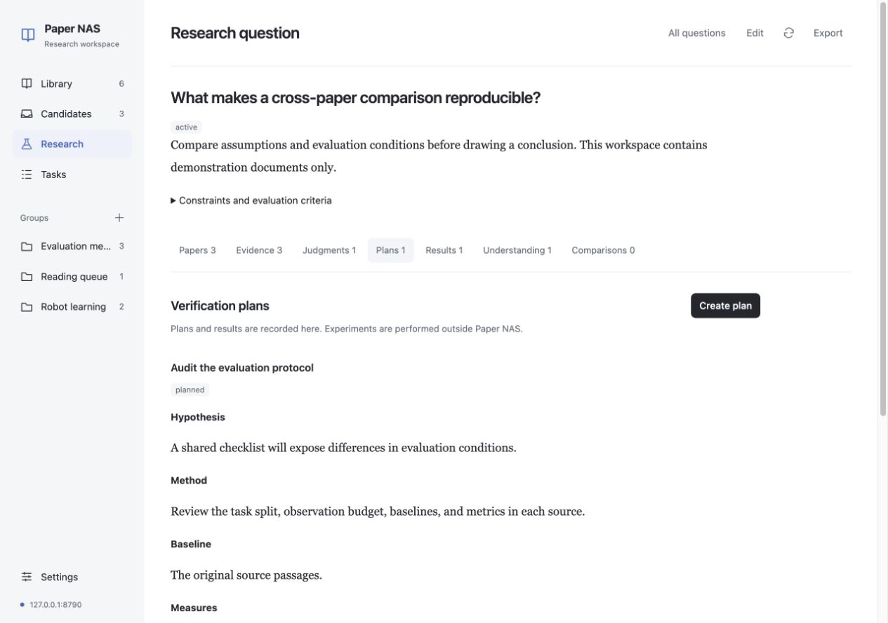
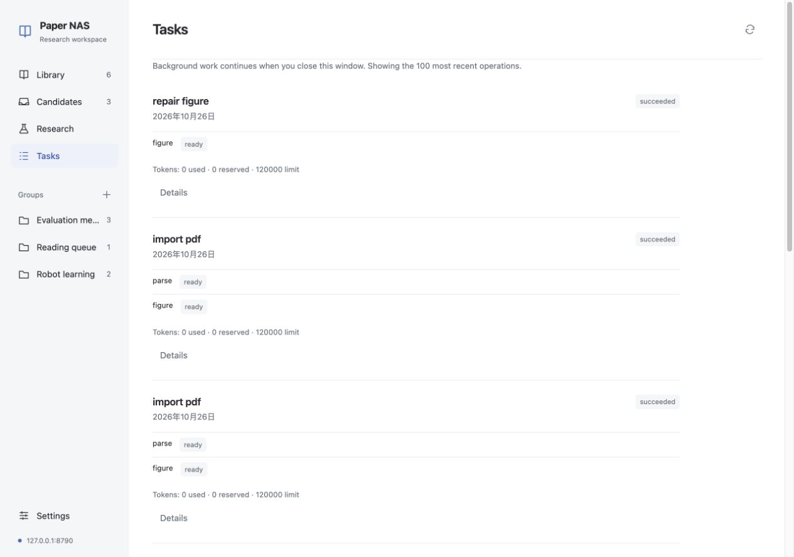
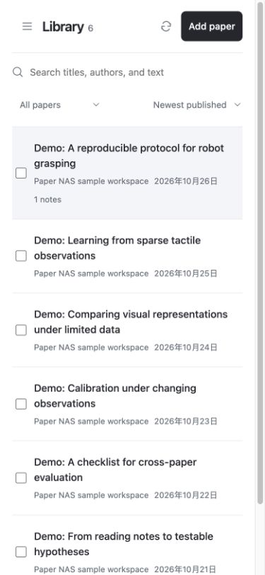

# Paper NAS in use

These screenshots were captured from the running browser and native Mac clients on 2026-10-26. They use an isolated local workspace containing six synthetic papers, three candidates, and an example research question. Paper titles, text, notes, and research records are demonstration content. The diagram is a conceptual illustration, not a validated scientific result.

No personal library, model credentials, or production deployment details appear in these images. The task history shows real local imports, parsing, and a figure-region repair. No paid model calls were used to prepare this gallery.

[Project overview](../README.md) · [中文介绍](README.zh-CN.md) · [Feature boundaries](FEATURES.md)

## Browser library

Search papers, browse groups, and move candidates into your reading workflow.

## Dark appearance

The same library with the browser's dark appearance enabled.

## Original PDF

Read the source PDF and switch to extracted text, figures, notes, or a saved analysis.

## Source figures

A figure keeps its source page and can be saved as research evidence. The example region was corrected through the actual application and processed by its worker.

## Research evidence

Exact quotations retain their source version and page. The example question links three papers and their evidence.

## Verification plans

Record a hypothesis, method, baseline, measures, success criterion, stopping condition, and budget. Experiments are performed outside Paper NAS; plans and results are recorded here.

## Durable tasks

The server continues import and processing work when the client closes. The screenshot shows completed imports and figure repair.

## Native Mac library

The SwiftUI client connects to the same API and shows the same papers and groups.

## Native Mac reader

PDFKit renders the original document beside a page-linked note. The embedded workflow is synthetic demonstration material.

## Mobile browser

The browser adapts to a 390-pixel viewport, with navigation behind the menu button.

